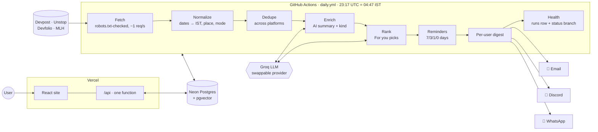
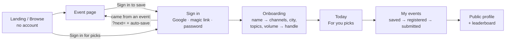
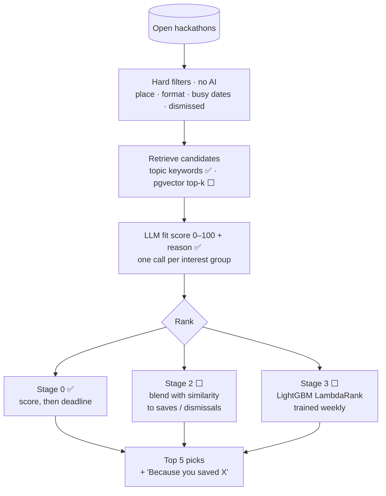
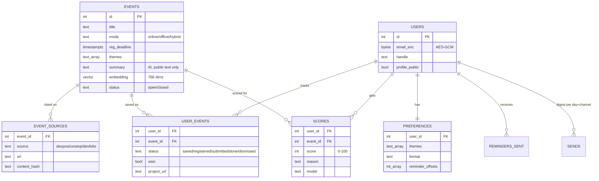

# HackRadar

**A daily hackathon digest that finds what's open, ranks it for you, and reminds you before it
closes.**

HackRadar checks Devpost, Unstop and Devfolio every morning. It keeps the events that fit where you
are and what you like, ranks them with an AI recommender, and sends you up to five picks on Discord,
email or WhatsApp at about 5 AM IST. Save an event and you get reminders 7, 3 and 1 days before its
deadline, and on the day.

**Live:** [hackradar-two.vercel.app](https://hackradar-two.vercel.app) · browsing needs no account


---

## What it does

| | |
|---|---|
| 🔎 **Collects** | Open hackathons from public listing APIs (Devpost, Unstop, Devfolio; MLH next), deduplicated across platforms. An event on 2+ sites gets a badge. |
| 🎯 **Ranks** | Hard filters (city + radius, format, busy dates), then an AI fit score and a one-line reason for each pick. See [the recommender](#the-recommendation-engine). |
| 📬 **Delivers** | One message a morning per user, over the channels they choose: email (Gmail SMTP), Discord (their own webhook), WhatsApp (CallMeBot). |
| ⏰ **Reminds** | Save → Register → Submit flow with reminders 7/3/1/0 days out, Google Calendar links and a personal ICS feed. |
| 🏆 **Shows off** | Public profile `/u/<handle>` with an activity grid and an interest graph, plus a leaderboard where points need a project link. |

Two principles run through all of it:

- **Dates and prizes always come from the source listing, never from AI.** The source link is
  always shown.
- **No personal data goes to AI.** Only public event text and interest tags are sent.

---

## How it works

Nothing has to stay running. One GitHub Actions job writes all event data once a day. Vercel only
serves what people click.



Every source module implements one `Source` interface and fails on its own: a broken source is
logged and the run continues. A source that returns 0 listings marks the run `partial` and raises
an alert.

### A user's path through the site



---

## The recommendation engine

The recommender is built in stages. Each stage falls back to the one before it, so ranking can
never block the digest.



| Stage | Idea | Status |
|---|---|---|
| **0 · LLM fit score** | Keyword shortlist of 12 events per interest group; an LLM rates fit 0–100 and writes a reason. Users with the same tags share one request, so cost grows with the number of distinct tag sets, not users. | ✅ live |
| **1 · Embeddings** | 768-dim event vectors in pgvector (TF-IDF fallback). Retrieval by meaning, not keywords. | ⬜ planned |
| **2 · Feedback blend** | `0.55·llm + 0.25·sim(saves) − 0.15·sim(dismissals) + 0.05·sim(topics)`, with cold-start handling. | ⬜ planned |
| **3 · Learned ranker** | LightGBM LambdaRank on graded labels (won > registered > saved > opened > ignored), trained weekly on CPU in GitHub Actions. Switches on after a data gate. | ⬜ planned |

How the privacy rules apply here:

- Saves and dismissals never leave the database.
- User vectors are built locally from event vectors.
- The learned model has no user-identity features at all.

**Full design:** formulas, features, labels, training pipeline, evaluation, exploration and failure
handling are in [docs/RECOMMENDER.md](docs/RECOMMENDER.md).

---

## Data model



Schema: [`pipeline/models.sql`](pipeline/models.sql) (idempotent) plus migrations in
[`pipeline/migrations/`](pipeline/migrations). Emails and CallMeBot keys are encrypted at rest.

---

## Tech stack

| Layer | Choice |
|---|---|
| Pipeline | Python 3.12 (`uv`), `psycopg` 3, `httpx`, `ruff` + `black` + `pytest` |
| Scheduler | GitHub Actions cron + manual dispatch, keepalive commit to a `status` branch |
| Database | Neon Postgres with `pgvector` and `pg_trgm` |
| AI | Groq (`openai/gpt-oss-120b`) behind a provider interface; Gemini and Claude adapters planned |
| Web | React 19, Vite, TypeScript, SWR, `d3-force`; hand-drawn "fun theme" in plain CSS tokens |
| API + hosting | One Vercel function (`web/api/index.ts`) with a small router |
| Auth | Email magic link, Google OAuth, Supabase email + password; our own cookie sessions |
| Channels | Gmail SMTP · Discord webhooks · CallMeBot WhatsApp |
| Planned ML | Gemini embeddings / TF-IDF, LightGBM LambdaRank |

---

## Run it locally

You need [uv](https://docs.astral.sh/uv/), Node 22+, and a Postgres database with `pgvector`
(a free Neon project works). Copy `.env.example` to `.env` and fill it in. The one-time
account and key setup is in [docs/SETUP.md](docs/SETUP.md).

```bash
uv sync
```

```bash
uv run python -m pipeline.db init
```

```bash
uv run python -m pipeline.run
```

```bash
uv run pytest -q
```

```bash
cd web && npm ci && npm run dev
```

DB tests skip unless `TEST_DATABASE_URL` is set, and they run in a throwaway schema. CI runs ruff,
black, pytest (against a pgvector service), vitest, the web build and `tsc`.

---

## Repository layout

```
pipeline/          daily job: sources/, normalize, dedupe, enrich, rank, reminders, digests, notify/
  ai/              provider adapters, summarize.py, score.py
  models.sql       schema · migrations/
web/               React + Vite site
  api/index.ts     the single Vercel function
  server/          auth, sessions, prefs, saves, picks, profile, leaderboard, calendar
  src/             pages/ and components/
config/            sources.yaml · settings.yaml · topics.yaml · places.yaml
tests/             unit tests + fixtures saved from real responses
docs/              context, architecture, decisions, roadmap, recommender, specs, research, sessions
.github/workflows/ daily.yml · ci.yml
```

---

## Status and roadmap

| Done | Next |
|---|---|
| Daily pipeline (3 sources), cross-platform dedupe, place filter | MLH and Hack2Skill sources |
| Website: browse, event pages, sign-in, onboarding, settings | LinkedIn/X discovery via search APIs (no logins) |
| Per-user digests on email, Discord, WhatsApp | Recommender Stages 1–2: embeddings + feedback blend |
| For you picks with LLM scores, busy dates | Impressions log → Stage 3 learned ranker |
| Save/register flow, reminders, calendar feed | Discord bot with Save / Not interested buttons |
| Public profiles, interest graph, leaderboard | `/ask` an AI about events |

Phase-by-phase checklist: [docs/ROADMAP.md](docs/ROADMAP.md).

---

## Sourcing rules

- Public APIs and robots.txt-allowed pages only, with a clear User-Agent at about 1 request per
  second per host.
- No logged-in scraping, no cookies, no unofficial WhatsApp libraries.
- Discovered social posts are always marked *unverified* and always link to the original.

## Documentation

| Doc | What's in it |
|---|---|
| [docs/CONTEXT.md](docs/CONTEXT.md) | Single source of truth: current status, stack, decisions index |
| [docs/ARCHITECTURE.md](docs/ARCHITECTURE.md) | Components, data flow, schema, pipeline steps, routes |
| [docs/RECOMMENDER.md](docs/RECOMMENDER.md) | The recommendation engine, all four stages |
| [docs/DECISIONS.md](docs/DECISIONS.md) | Every design decision, with why and alternatives |
| [docs/ROADMAP.md](docs/ROADMAP.md) | Phases, gates, task checklists |
| [docs/SETUP.md](docs/SETUP.md) | One-time setup and where each secret lives |

## License

[MIT](LICENSE) © 2026 Debjit
