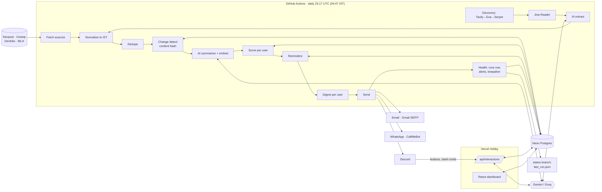

# HackRadar — Architecture

_Last updated: 2026-10-14_ · Status: **planned** (no code yet).

## Components

The daily job is the only thing that writes event data. Vercel only handles what people click or ask,
so nothing has to stay running.

| Component | Where | Does |
|---|---|---|
| Daily pipeline | GitHub Actions (`daily.yml`) | Fetch → normalize → dedupe → AI → score → reminders → digest → send → health |
| Database | Neon Postgres | Events, sources, users, preferences, saves, scores, reminders, runs |
| Bot | Vercel Python function `/api/interactions` | Discord slash commands and buttons (save, status, ask, filters…) |
| Dashboard | Vercel (React + Vite) | Browse events, saved, calendar, settings, admin health; Discord OAuth |
| AI providers | Gemini / Groq / (Claude) | Summaries, scores, extraction, `/ask`, embeddings — behind adapters |
| Discovery | Tavily / Exa / Serper + Jina Reader | Find public LinkedIn/X hackathon posts, no logins |
| Channels | Discord, Gmail SMTP, CallMeBot | Deliver digests and reminders |

## Data flow



## Data model (Postgres)

One canonical `events` row per hackathon; every place it was seen is tracked in `event_sources`, so
deduplication never loses a link. Schema file: `pipeline/models.sql` (not yet written).

| Table | Purpose | Key fields |
|---|---|---|
| `events` | One row per unique hackathon | id, title, organizer, mode (online/offline/hybrid), city, country, reg_deadline, start_date, end_date, submission_deadline, prize_text, themes[], eligibility, team_size, invite_only, summary (AI), embedding, first_seen_at, updated_at, status (open/closed) |
| `event_sources` | Each listing of an event on a platform | event_id, source, source_id, url, raw_json, content_hash, last_seen_at |
| `users` | Owner and friends | id, name, discord_user_id, email (encrypted), callmebot_phone + key (encrypted), channels[], digest_enabled, timezone |
| `preferences` | Per-user filters and profile | user_id, themes[], skills[], locations[], modes[], student_only, min_prize, reminder_offsets (default {7,3,1}) |
| `user_events` | Saves and status | user_id, event_id, status (saved/registered/submitted/done/dismissed), snoozed_until, created_at |
| `scores` | Per-user fit score | user_id, event_id, score 0–100, reason, model, scored_at |
| `reminders_sent` | Prevents duplicate reminders | user_id, event_id, date_field, offset_days, channel, sent_at |
| `runs` | Health of each daily run | run_id, started_at, per-source counts + errors, notifications_sent, status |

**Rules**
- A `content_hash` change → event re-summarized; reminders recomputed if dates changed.
- CallMeBot keys and emails encrypted with a key from GitHub Secrets / Vercel env (D-024).
- Personal data never goes to AI; only public event text.
- Embedding storage type (pgvector vs float array) — open; Neon supports pgvector (unverified on free tier).

## Daily pipeline

One job, ~5–10 min. A failing source or AI call is logged and skipped, never fatal.

1. **Fetch.** Each source module returns raw listings: Devpost public JSON (40/page, paginated),
   Unstop `/api/public/*`, Devfolio listing, MLH season page; discovery (~10 Tavily queries/day).
2. **Normalize.** Map to the common event shape. Dates → IST. Parse mode, city, prize.
3. **Extract.** For discovered posts: Jina Reader fetches the public page, AI extracts title, dates, link,
   themes. Drop posts without a registration link.
4. **Deduplicate.** Fuzzy title + same organizer + overlapping dates → one `events` row; keep all URLs.
5. **Detect changes.** New or hash-changed events go to AI. Past events marked closed.
6. **Summarize.** Gemini, 10–15 events per call; then embeddings.
7. **Score per user.** Rule filters (location, mode, eligibility, invite_only) first; then AI score blended
   with similarity to saves, minus similarity to dismissals.
8. **Reminders.** Offsets from user settings (default 7/3/1 + same day). Date by status: Saved → reg
   deadline; Registered → start + submission deadline; Submitted → result date if known. Skip anything in
   `reminders_sent`.
9. **Digest per user.** Top 5 fits · closing within 3 days · 2–3 AI picks with reasons · other options
   (compact) · "Because you saved X".
10. **Send** via each user's channels.
11. **Health.** Write `runs` row; Discord alert if a source returns 0 two days running or the run fails;
    commit `data/last_run.json` to the `status` branch.

## Repo layout (planned)

```
hackradar/
├── pipeline/
│   ├── sources/        base.py devpost.py unstop.py devfolio.py mlh.py discovery.py
│   ├── normalize.py  dedupe.py
│   ├── ai/             gemini.py groq.py claude.py  prompts/
│   ├── ranking.py  reminders.py  digest.py
│   ├── notify/         discord.py email.py whatsapp.py
│   ├── db.py  models.sql  migrations/
│   └── run.py          # python -m pipeline.run
├── bot/                # Vercel Python function: /api/interactions
├── web/                # React + Vite dashboard (fun theme SPA)
│   ├── src/
│   │   ├── components/ # Nav, Footer, Monitor, Quip, Icon, PrefsForm, PasswordSignIn
│   │   ├── pages/      # Home (Landing/Today), Events, EventDetail, MyEvents, SignIn, Setup, Admin
│   │   ├── lib/        # api.ts, auth.ts, time.ts
│   │   └── styles.css  # Hand-drawn fun theme design tokens and component styles
├── tests/              # fixtures/ (saved real responses) + unit tests
├── config/             sources.yaml settings.yaml
├── data/last_run.json  # lives on the status branch (D-023)
├── docs/               # ARCHITECTURE, CONTEXT, DECISIONS, ROADMAP, design/DESIGN.md
└── .github/workflows/  daily.yml ci.yml
```

## Web frontend (`web/`)

Built with React 18, Vite, and TypeScript. Styled with vanilla CSS design tokens (`web/src/styles.css`) following the hand-drawn "fun theme" (D-047, [design/DESIGN.md](design/DESIGN.md)).

### Routes

| Route | Component | Access | Description |
|---|---|---|---|
| `/` | `Home` | Public / Auth | Landing page (hero, how it works, blueprint preview, checklist) when signed out; Today feed (top picks, deadline list) when signed in |
| `/events` | `Events` | Public | Public searchable directory with query filter, closing-soon / nearest tabs, pagination |
| `/events/:id` | `EventDetail` | Public | Event tablet card, real-date countdown sticker, notched ticket stub, AI summary label, Ask an AI card |
| `/my-events` | `MyEvents` | Signed-in | Saved events timeline & scrapbook shell (empty state with `TODO(backend)`) |
| `/welcome` | `Welcome` | Signed-in | Onboarding questionnaire (4 playful steps: notification channels, home base, themes, volume) |
| `/settings` | `Settings` | Signed-in | Preferences editor (same 4-step form with live Discord webhook test & CallMeBot key) |
| `/signin` | `SignIn` | Signed-out | Google OAuth, email magic link, and Supabase password authentication |
| `/signin/confirm` | `ConfirmSignIn` | Public | OTP / magic-link token verification handler |
| `/admin` | `Admin` | Signed-in (Owner) | System status, run logs, trigger pipeline run |

### Key Components

- `Monitor` (`src/components/Monitor.tsx`): Mascot logo with stand, coral screen, cycling faces (sleepy, awake, focused, happy, reading, sad, hands-over-eyes).
- `Quip` (`src/components/Quip.tsx`): Floating mascot speech bubble with 30–90 s random intervals, 4.5 s display, click-through courtesy, and pause when tab hidden.
- `Nav` (`src/components/Nav.tsx`): Handwritten navigation links with drawn SVG loops on hover/active, caption chips, mascot hover reaction, and responsive layout.
- `Footer` (`src/components/Footer.tsx`): Continuous marquee source ticker, coral wavy separator, link directory, sleeping mascot doodle, and source-trust guarantee.
- `Icon` (`src/components/Icon.tsx`): Hand-drawn SVG line icon set (`pin`, `bulb`, `code`, `sparkle`, `clock`, `wifi`, `heart`, `cup`, `rocket`, `trophy`, `people`, `ticket`, `monitor`).
- `PrefsForm` (`src/components/PrefsForm.tsx`): Interactive 4-step preferences editor with interactive slider distance vibes, channel testing, and reactive mascot commentary.

