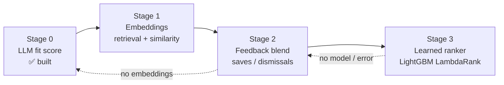
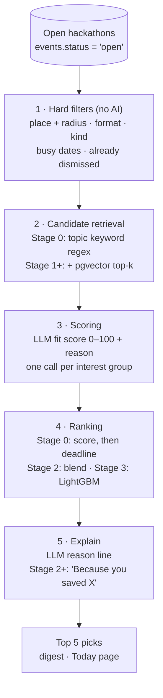
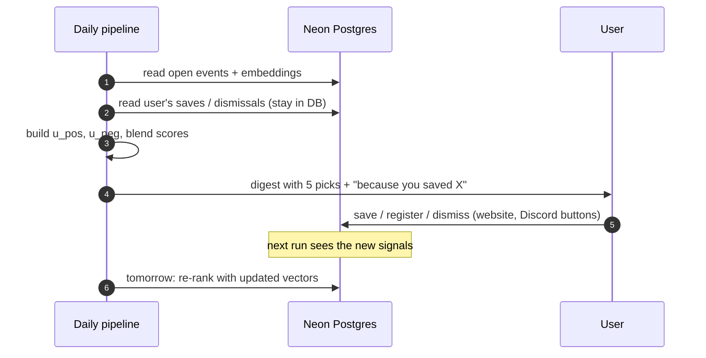
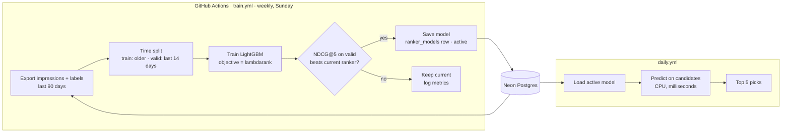

# HackRadar — Recommendation engine

_Last updated: 2026-11-03_ · Decision: [D-059](DECISIONS.md) · Code today: [`pipeline/rank.py`](../pipeline/rank.py), [`pipeline/ai/score.py`](../pipeline/ai/score.py), [`pipeline/user_digest.py`](../pipeline/user_digest.py)

The recommender decides which open hackathons go into each user's **For you** picks (digest and
Today page) and writes the one-line "why" under each pick. It is built in stages. Each stage keeps
the previous one as its fallback, so a missing key, an empty table or a failed model never stops the
daily digest.

| Stage | What ranks the events | Status |
|---|---|---|
| **0 · LLM fit score** | Hard filters → keyword shortlist → LLM scores 0–100 per interest group | ✅ built (D-051, D-054) |
| **1 · Embeddings** | Vector retrieval and similarity on event text (pgvector) | ⬜ planned (Phase 4) |
| **2 · Feedback blend** | Weighted mix of LLM score, similarity to saves, distance from dismissals | ⬜ planned (Phase 4) |
| **3 · Learned ranker** | LightGBM LambdaRank trained weekly on real interactions | ⬜ planned, starts after a data gate |



## Ground rules (apply to every stage)

- **No personal data to AI.** The LLM and the embedding model only ever see public event text and
  interest tags (topics, format). Never a name, email, handle, user id or history (CLAUDE.md, D-051).
- **Saves and dismissals never leave our database.** User vectors (Stage 1) and features (Stage 3)
  are computed in the pipeline, from event vectors we already store.
- **Dates and prizes come from the source.** The model ranks; it never writes a date, prize or fee.
  "Why" lines that mention them are blanked ([`score.py`](../pipeline/ai/score.py) `_EXTRA_BANNED`).
- **Event text is untrusted.** It sits inside `<event>` blocks, angle brackets are stripped from
  titles, and the system prompt says to ignore instructions inside it.
- **Cost stays flat as users grow** (D-044). Users with the same interest tags share one LLM
  request, and features carry no user identity, so one model serves everyone.
- **Never fatal.** Ranking runs on its own DB connection; any failure is logged and the digest goes
  out with deadline order.

## The funnel

All stages fit the same retrieve → score → rank → explain funnel. Stage 0 uses keywords for
retrieval; Stage 1 adds vectors; Stages 2 and 3 replace only the ranking step.



---

## Stage 0 · LLM fit score (built)

Runs daily in GitHub Actions after enrichment and before sends (D-054).

1. **Group users** by `(sorted topics, format)`. One AI call per group, largest groups first.
2. **Shortlist** with [`config/topics.yaml`](../config/topics.yaml): each topic has whole-word,
   case-insensitive keywords. An event matching more of the group's topics ranks higher; ties go to
   the sooner deadline. Up to `rank.shortlist` = **12** events per group. Events already scored for
   every user in the group are skipped, so a re-run costs nothing.
3. **Score.** Groq (`openai/gpt-oss-120b`, JSON mode) gets the interests, the format and the 12
   events, and returns `{"id", "score": 0–100, "reason"}` for each.
4. **Validate.** Unknown ids and out-of-range scores are dropped. A reason over 160 characters, or one
   that has links, handles, dates or prize words, is blanked.
5. **Store** one `scores` row per user × event (`score`, `reason`, `model`, `scored_at`).
6. **Pick** ([`user_digest.py`](../pipeline/user_digest.py) `_picks`): only events with a score row,
   non-clashing first, then score high to low, then deadline. Top `digest.top_n` = **5**.

**Budgets:** `rank.max_groups` = 40 calls and `rank.max_seconds` = 480 s per run. A rate limit
stops scoring for the run; any other failure skips only that group. Changing topics or format
deletes the user's scores so they are rescored.

**Limits this stage leaves:**
- Keywords miss events that use other words ("LLM agents" without "ai") and can't rank fit within
  a topic.
- It ignores behaviour: someone who saves only beginner Web3 events is ranked like every other
  Web3 user.
- Its reasons are generic, and the only signal is the LLM's judgement.

---

## Stage 1 · Embeddings (planned)

**Goal:** find events by meaning, not keywords, and give every event and user a vector to compare.

**Event vectors.** For each new or changed event (the content hash already tells us which), embed
`title + themes + AI summary`, all public text. Model: a Gemini embedding model at **768 dims**
(D-026). The column `events.embedding vector(768)` already exists. Vectors are L2-normalised, so
cosine similarity is a dot product. Gemini free-tier limits are **unverified**; re-check and write a
research note before building.

**Fallback (D-035):** if no embedding key is available, use TF-IDF over `title + themes + summary`
with scikit-learn, fitted on the open events each run. It's weaker, but it costs nothing and works offline.

**User vectors.** These are computed locally, so nothing is sent anywhere:

| Vector | Built from | Meaning |
|---|---|---|
| `u_topics` | Embeddings of each chosen topic's description (from `topics.yaml`), averaged; cached per topic | What they said they like |
| `u_pos` | Weighted mean of event vectors they saved / registered / submitted / won | What they actually do |
| `u_neg` | Mean of event vectors they dismissed | What they push away |

Interaction weights for `u_pos`: saved 1, registered 2, submitted 3, won 3. Time decay has a
half-life of **60 days**, so a change in interests shows up within weeks. All weights are proposals,
tunable in `settings.yaml`.

**Retrieval.** Each user's candidates are the union of the keyword matches (Stage 0) and the
pgvector nearest neighbours of `u_topics` (and `u_pos` when present) among open events, with
**k = 20**, using an HNSW index on `events.embedding`. The scoring step then sees more relevant
events than keywords alone would find.

**Storage:** no new table for events. User vectors are recomputed each run (cheap: a few hundred
saves at most per user), so there's nothing to keep in sync.

---

## Stage 2 · Feedback blend (planned)

**Goal:** move each user's ranking toward what they save and away from what they dismiss, and
explain it.

For a user *u* and a candidate event *e* (with *e* also standing for the event's vector), all terms
are scaled to 0..1:

```
final(u, e) = w_llm · llm(u, e) / 100
            + w_pos · sim(e, u_pos)
            − w_neg · sim(e, u_neg)
            + w_top · sim(e, u_topics)
```

`sim` is cosine similarity mapped from [-1, 1] to [0, 1].

| Weight | Start value | Notes |
|---|---|---|
| `w_llm` | 0.55 | The LLM's topic and format judgement |
| `w_pos` | 0.25 | Moved to `w_llm` while the user has fewer than 3 positive interactions (cold start) |
| `w_neg` | 0.15 | Applies only when the user has dismissals |
| `w_top` | 0.05 | Tie-breaker; also the main score for an event the LLM hasn't scored yet |

The start values are a guess, set in `settings.yaml` under `rank.blend`. Stage 3 replaces the
hand-set weights with learned ones. Hard filters and the "non-clashing first" rule still come
before the blend.

**"Because you saved X."** For each pick, find the user's saved event with the highest cosine
similarity. If it is at least **0.80** (to tune), the digest line reads *"Because you saved
&lt;title&gt;"*. It's computed locally with no AI call, and always names a real event the user chose.

**Feedback loop:**



---

## Stage 3 · Learned ranker (planned)

**Goal:** learn how much each signal matters from what users actually did, instead of hand-set
weights.

### Model choice

**LightGBM LambdaRank**, a gradient-boosted tree model trained on a ranking objective (NDCG).

- It trains in seconds to minutes on CPU, so a free GitHub Actions runner is enough.
- It handles a mix of numeric and categorical features and missing values without much prep.
- It optimises the order of the list, which is what a top-5 digest needs, rather than a
  per-item probability.
- The model file is small (a text dump), and you can inspect it: feature importance shows what
  drives the ranking.

Considered and rejected for now: two-tower neural retrieval (needs far more interaction data and a
GPU to train); matrix factorisation or collaborative filtering (events live only a few weeks, so
item factors never mature, and every event is cold); a managed ML service (adds a vendor and
cost, against D-044's "start free").

### Training data

**Missing today, needed first: an `impressions` log.** We know what users saved, but not what they
were shown and ignored. Without that, the model can't learn what a negative looks like.

Proposed table (a migration when this stage starts):

| Column | Meaning |
|---|---|
| `user_id`, `event_id` | Who saw what |
| `shown_on` | IST date |
| `surface` | `digest_email` · `digest_discord` · `digest_whatsapp` · `today` |
| `position` | 1..5 in the picks list |
| `ranker` | `llm` · `blend` · `lgbm:<version>`, i.e. which stage produced the list |
| `features` | `jsonb` snapshot of the feature vector at serve time (avoids training/serving skew) |

Plus click tracking: digest links go through a redirect (`/r/<signed token>`) that logs an
`opened` event, then forwards to the event page. Proposed.

**Labels** (graded relevance, joined from `user_events` within 14 days of the impression):

| Outcome | Label |
|---|---|
| Won or submitted (with project link) | 4 |
| Registered | 3 |
| Saved | 2 |
| Opened the event page from the pick | 1 |
| Shown, no action | 0 |
| Dismissed | 0, and also feeds `u_neg` |

**Query groups:** one group = one user on one day. LambdaRank learns the order within each
day's list.

### Features

No user identity is a feature: no user id, name, city string or email. That keeps the model
general (new users get good results on day one) and private.

| Group | Features |
|---|---|
| Relevance | `llm_score`, `keyword_hits`, `sim_topics`, `sim_pos`, `sim_neg`, `max_sim_to_a_save` |
| Timing | `days_to_reg_deadline`, `days_to_start`, `event_length_days`, `is_weekend`, `clashes_busy` |
| Logistics fit | `mode` (online/offline/hybrid), `mode_matches_pref`, `distance_km_bucket`, `team_size_fits` |
| Event quality | `has_prize`, `prize_inr_log` (from source fields), `entry_fee_free`, `sources_count` (listed on 2+ platforms), `invite_only`, `kind` |
| User activity (not identity) | `user_positive_count_bucket`, `user_days_since_last_save_bucket` |
| Position (bias) | `position`. Used in training, set to 1 for everyone at serving time so the model doesn't learn "top slot = good" |

### Training pipeline



- **Where:** a new workflow `train.yml` (weekly cron + manual dispatch) on `ubuntu-latest`, Python
  3.12 via `uv`. New dependencies: `lightgbm`, `numpy` (and `scikit-learn` for the Stage 1
  TF-IDF fallback).
- **Model store:** a `ranker_models` table (`version`, `model_txt`, `feature_names`,
  `metrics jsonb`, `trained_at`, `active`). It needs no new service, rollback is a one-line
  `UPDATE`, and the daily job already has the DB connection. Models are a few hundred KB.
- **Promotion rule:** a new model goes live only if, on the held-out last 14 days, NDCG@5 beats the
  active ranker (Stage 2 blend or the previous model) by at least **2 % relative**. Every
  candidate's metrics are logged.
- **Hyperparameters to start:** `num_leaves` 31, `learning_rate` 0.05, up to 500 rounds with early
  stopping on validation NDCG@5, `min_data_in_leaf` 20. Tuned later only if the data supports it.

### When Stage 3 switches on (data gate)

Training on too little data learns noise. Stage 3 stays off until there is at least:

- **5,000 impressions**, **300 positive labels** (label ≥ 2), from **50+ distinct users**,
  over 4+ weeks.

These thresholds are proposals and **unverified**; revisit them once the impressions log exists.
Until the gate is met, Stage 2 serves and the impressions log keeps collecting.

### Evaluation

| Offline (each training run) | Online (after promotion) |
|---|---|
| NDCG@5 (main), MAP@5, recall@5 of saves | Save rate per impression, registration rate |
| Per-segment check: new users, offline-only, beginners | Dismiss rate (should not rise) |
| Feature importance sanity check (e.g. `position` must not dominate) | A/B split by `hash(user_id) % 2` for the first 2 weeks |

### Exploration

A ranker trained on its own picks only learns about events it already shows. To keep discovering,
**1 of the 5 slots** is filled from ranks 6–20 with probability **0.1**, logged as an exploration
impression. This is proposed; it's off for new users in their first week.

### Failure handling

| Failure | Behaviour |
|---|---|
| No active model, or it fails to load | Stage 2 blend |
| No embeddings for an event | Similarity features left empty (LightGBM handles missing values); Stage 2 uses `w_llm` only |
| No LLM score (rate limit, no key) | `llm_score` empty; ranking falls back to similarity and deadline |
| Any exception in ranking | Logged; digest sends with deadline order (today's behaviour) |

---

## Build order

1. **Stage 1:** Gemini embedding adapter + TF-IDF fallback, embed on content-hash change, HNSW
   index, vector retrieval into the shortlist. Research note on Gemini embedding free limits first.
2. **Stage 2:** `rank.blend` weights in `settings.yaml`, blend in `_picks`, "Because you saved X"
   lines in all three channels and the Today page.
3. **Impressions log + click redirect.** Ship it together with Stage 2 so data piles up while Stage 2 serves.
4. **Stage 3:** `train.yml`, `ranker_models` table, feature export shared by training and serving,
   promotion rule, A/B split. Switch it on only after the data gate.

Each step gets a fixture test and an entry in [ROADMAP.md](ROADMAP.md) Phase 4.
