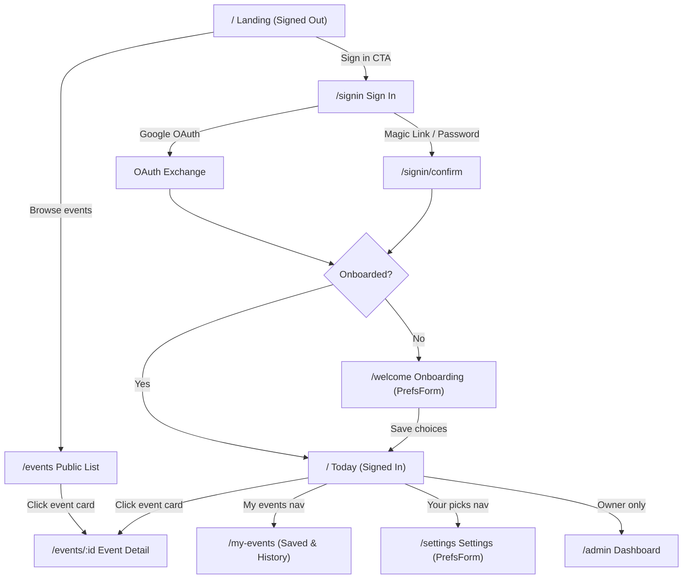

# HackRadar — Design System & Architecture Reference (`DESIGN.md`)

## 1. Purpose
A hand-drawn, builder-centric web theme pairing charcoal frames, warm cream paper surfaces, vibrant coral stamps, and an expressive monitor mascot to turn daily hackathon hunting into a delightful morning ritual.

---

## 2. Tokens

### Colors
| Token | Hex / Value | Usage |
|---|---|---|
| `--charcoal` | `#1f1e1d` | Main page background, outer dark frame canvas |
| `--coal` | `#161514` | Deep contrast surfaces (radar display, code blocks, dark card posters) |
| `--cream` | `#f3e7d7` | Primary warm paper surfaces, speech bubbles, graph cards |
| `--cream-2` | `#e9dccb` | Secondary tinted paper (torn notes, scene boxes, subtle containers) |
| `--coral` | `#e5484d` | Core brand accent, CTA buttons, stamp highlights, tablet frame border |
| `--coral-text`| `color-mix(in oklch, var(--coral), white 24%)` | Accessible high-contrast coral text on dark charcoal |
| `--coral-deep`| `color-mix(in oklch, var(--coral), black 14%)` | Deep stroke coral for hand-drawn lines on paper |
| `--ink-red` | `#9b2b2f` | Graph paper grid lines, hand-drawn strokes on cream, card borders |
| `--ink` | `#2a1615` | High-contrast text on cream paper |
| `--ink-soft`| `#5a3532` | Secondary body text on cream paper |
| `--chalk` | `#ede6dc` | Primary text and line art on dark charcoal |
| `--mute` | `#a59d93` | Metadata, timestamps, helper labels on dark backgrounds |
| `--line-dark`| `#34312e` | Subtle dividers and border lines on dark charcoal |
| `--grid` | `color-mix(in oklch, var(--ink-red) 13%, var(--cream))` | Mathematical 26px x 26px graph paper grid lines |

### Typography
- **Heading Serif (`--serif`):** `"Young Serif", Georgia, serif` — Used for bold hero statements (`h1`), section titles (`h2`), card titles (`h3`).
- **Handwritten Script (`--hand`):** `"Gochi Hand", cursive` — Used for brand logo, navigation links, stamp labels, speech bubbles, handwritten notes, and sticker badges.
- **Body Sans (`--sans`):** `"Instrument Sans", system-ui, sans-serif` — Modern, ultra-readable grotesque sans used for body text, button labels, and input fields.
- **Monospace (`--mono`):** `"DM Mono", ui-monospace, monospace` — Used for dates, metadata tags, source tickers, and code snippets.

### Spacing & Layout
- **Content Max Width:** `1120px` centered with auto margins.
- **Frame Padding:** `clamp(16px, 4vw, 32px)` horizontal padding.
- **Touch Targets:** Minimum 44px height on all interactive elements (buttons, inputs, links, chips, cells).

### Radii
- Pill badges & chips: `999px`
- Rounded buttons & inputs: `12px`
- Standard cards & shots: `16px`–`20px`
- Tablet card & sheets: `28px`

---

## 3. Components

### `<Monitor />`
- **Description:** Hand-drawn cathode monitor mascot on a stand with coral screen and animated faces.
- **Props:**
  - `mood?: "idle" | "sleep" | "wake" | "focus" | "happy" | "read" | "sad" | "google" | "email" | "password"`
  - `sleepy?: boolean`
  - `happy?: boolean`
  - `size?: number | string`
  - `className?: string`, `style?: CSSProperties`
- **States:**
  - `idle`: Cycles through sleepy, awake, focused, and happy every ~2s with gentle bobbing.
  - `happy`: Hops and smiles on hover over logo or any nav link.
  - `sleep`: Emits floating "z" particle animations (used in footer and sleep states).
  - `read`: Reading face when email input field is active.
  - `password`: Mascot covers eyes with hand graphics when entering sensitive password input.
  - `sad`: Drooped expression when user hesitates or hovers "Skip".

### `<Quip />`
- **Description:** Small cream speech bubble attached below/beside logo mascot showing humorous lines or thought-provoking questions.
- **Behavior:**
  - Displayed for ~4.5 s, then disappears for a random gap of 30–90 s.
  - Immediate trigger on logo hover via `sayNow()`.
  - Automatically paused while browser tab is hidden (`document.hidden`).
  - Does not block user clicks (`pointer-events: none`).
  - Rendered only when active.
  - Static fallback list with `// TODO(backend): replace with daily AI-generated lines`.

### `<Nav />`
- **Description:** Handwritten navigation bar shared across all pages.
- **Signed out state:** `how it works` (`/#how`), `browse` (`/events`), `your picks` (`/signin`), `sign in` (pill).
- **Signed in state:** `today` (`/`), `my events` (`/my-events`), `your picks` (`/settings` or `/welcome`), optional `admin` (`/admin`), `sign out` (pill).
- **Interactions:** Hovering any link draws an SVG loop around the text (`stroke-dashoffset` transition) and reveals a small coral handwritten caption (`.cap`). The active page preserves its loop (`.here`).

### `<Footer />`
- **Description:** Shared bottom bar across all pages.
- **Sub-elements:**
  - Infinite marquee ticker of data sources (`Devpost · Unstop · Devfolio · MLH · Luma · LinkedIn & X posts`). Pauses on hover.
  - Hand-drawn coral wave divider (`.foot-wave`).
  - Brand tagline: "Hackathons near you, every morning. Made in Pune for people who build on **weekends**."
  - Navigation link columns: Explore, Messages.
  - Sleeping monitor mascot with bedtime text ("next list lands around 5 AM IST").
  - Trust guarantee: "Dates and prizes come from the source, never from AI." · "Free · no card · one message a morning at most".

### Paper Surfaces
- **Tablet Card (`.tablet.grid-paper`):** 12px solid coral border enclosing graph paper, 28px border-radius, floating drop shadow. Used for Hero, Sign-in, and Event Detail.
- **Sheet (`.sheet`):** Cream paper card with top ribbon graphic and torn sticky notes. Used for "How it works".
- **Ruled Torn Note (`.ruled.torn`):** Graph-ruled lined paper with jagged torn top edge and translucent tape strip (`.tape`).
- **Framed Shot Card (`.shot`):** Cream-framed photograph-style hackathon card with slight rotation (`--r`), color-coded poster header, metadata facts, and source stamp. Straightens and lifts on hover (`translateY(-6px) scale(1.03)`).
- **Polaroid (`.polaroid`):** Physical photo mockup with handwritten caption and SVG scribble that traces itself on hover. Used for social discoveries (LinkedIn/X finds).
- **Ticket Stub (`.facts-row`):** Cream card with semicircular notches on left and right borders with dashed perforation lines. Used for key facts (Where, Prize, Team, Fee).

### Controls & Inputs
- **Buttons (`.btn`):** Solid coral (`.btn.solid` with 3px ink-red shadow), Ghost (`.btn.ghost`), and Chalk (`.btn.chalk`). Lift and scale on hover.
- **Checklist (`.chk`):** Handwritten list with square box. Clicking animates checkmark draw and strikethrough line across text while advancing the scene SVG illustration.
- **Chips (`.chip`):** Pill-shaped filter chips that tilt on active selection (`.chip.on`).
- **Segmented Control (`.seg`):** Joined toggle group for priority levels (ping me! / digest / nah) and event formats.
- **Switch (`.switch`):** Hand-drawn toggle switch with sliding ink dot.
- **Matrix Cell (`.cell`):** Grid checkbox button with hand-drawn tick for notification routing.

### `<Icon />`
- Vector SVG hand-drawn mini icons: `pin`, `bulb`, `code`, `sparkle`, `clock`, `wifi`, `heart`, `cup`, `rocket`, `trophy`, `people`, `ticket`, `phone`, `calendar`, `plane`, `check`, `search`, `discord`, `email`, `whatsapp`.
- Plain text face fallbacks: `[^‿^]`, `[o_o]`, `[^o^]`, `[-_-]zz`.

---

## 4. Motion & Reduced Motion

| Animation | Trigger / Target | Duration / Curve | Purpose |
|---|---|---|---|
| `rise-card` | Tablet mount (`.tablet.enter`) | 1.1s cubic-bezier(0.16, 1, 0.3, 1) | Hero tablet entry |
| `fade-up` | Subcontent (`.in`) | 0.8s 0.45s cubic-bezier(0.2, 0.8, 0.2, 1) | Staggered content fade-in |
| `draw` | Scope lines, ribbons (`.draw`) | 1.8s ease-out | Handwritten strokes drawing themselves |
| `spin` | Radar sweep (`.sweep`) | 4s linear infinite | Rotating radar beam |
| `ping` | Radar blips (`.blip`) | 4s ease-out infinite | Pulsing hackathon radar contacts |
| `bob` | Background doodles (`.doodle`) | 6s ease-in-out infinite | Gentle floating effect |
| `pc-bob` | Mascot monitor (`.pc`) | 4s ease-in-out infinite | Gentle mascot breathing/swaying |
| `pc-hop` | Mascot hover (`.brand:hover .pc`) | 0.6s ease-in-out infinite | Excited bouncing response |
| `rot` | Rotating words (`.rot > span`) | 9s cubic-bezier(0.2, 0.8, 0.2, 1) | Carousel of handwritten headlines |
| `marquee` | Source ticker (`.track`) | 30s linear infinite | Smooth source marquee; pauses on hover |
| `quip-pop` | Quip speech bubble (`.quip.show`) | 0.4s cubic-bezier(0.34, 1.56, 0.64, 1) | Bouncy speech bubble pop-in |
| `flow` | Divider squig (`.squig path`) | 1.6s linear infinite | Moving dash flow |

### Reduced Motion Guarantee
Under `@media (prefers-reduced-motion: reduce)`:
- All animation durations are forced to `0.001ms`.
- All iteration counts are capped at `1`.
- Transition durations are forced to `0.001ms`.
- All SVG stroke-dashoffset properties immediately resolve to `0` without animation.
- Scroll behavior is instantaneous (`auto`).

---

## 5. Copy & Tone

- **Voice:** Direct, warm, builder-to-builder, lighthearted, never corporate or bureaucratic.
- **Guarantees:** Always explicit that dates, prizes, and links come from source listings, never hallucinated by AI.
- **Privacy:** No personal information sent to AI; only public event descriptions. No personal data in fun copy except the user's first name in greetings.
- **Text Faces:** Used in plain-text channels (email subjects, WhatsApp text) to echo the monitor mascot:
  - Happy: `[^‿^]`
  - Neutral / Curious: `[o_o]`
  - Excited: `[^o^]`
  - Sleepy: `[-_-]zz`

---

## 6. User Flow

### Route Requirements from API
- `/` (Signed out): Fetches `/api/events?limit=6` for real public blueprint board.
- `/` (Signed in): Fetches `/api/me/prefs` for user location/filters, `/api/events` for personal feed.
- `/events`: Fetches `/api/events` (with `q`, `kind`, `place`, `radius`, `offset`, `limit`) and `/api/places`.
- `/events/:id`: Fetches `/api/events/:id` for full details, dates, sources, and AI summary.
- `/signin`: Fetches `/api/auth/providers` to detect enabled authentication methods.
- `/welcome` & `/settings`: Fetches `/api/me/prefs` and `/api/places`, writes `PUT /api/me/prefs`, tests webhook via `POST /api/me/prefs/test-discord`.
- `/my-events`: Currently client shell; awaits user saves backend.
- `/admin`: Fetches `/api/admin/stats` (requires admin session).

---

## 7. Screen-by-Screen Notes

1. **Landing (`/` signed out):**
   - Matches `Main.dc.html` layout.
   - Real events from `/api/events?limit=6` populate the blueprint board; no hardcoded dummy data.
   - Interactive checklist animates the scene illustration step-by-step.
2. **Sign In (`/signin` & `/signin/confirm`):**
   - Matches `SignIn.dc.html` layout.
   - Google button displayed first, followed by wavy "or" divider with spinning stamp.
   - Tabs for Magic Link vs. Password (powered by Supabase GoTrue adapter).
   - Mascot pal animates reactions: Google hover (hops), email focus (reading face), password focus (covers eyes with hands).
3. **Phone (Optional step):**
   - Inspected `web/server/prefs.ts` and `web/server/prefs-routes.ts`. `PUT /api/me/prefs` enforces full preference validation (`validatePrefs`), so a standalone phone-only route cannot save without the full preference state.
   - Per design instructions, phone fields are consolidated into Setup / Settings Part 1, documented under Needs Backend.
4. **Setup / Settings (`/welcome` and `/settings`):**
   - Matches `Setup.dc.html` layout.
   - Four playful parts: Where should we ping you? / Where's home base? / What gets you out of bed on a weekend? / How loud should we be?
   - Priority labels: `ping me!` (top), `digest` (normal), `nah` (off).
   - Real-time travel distance vibe text.
   - Dynamic mascot reaction to choices.
   - Preserves all webhook testing and security features.
5. **Today (`/` signed in):**
   - Matches `Today.dc.html` layout.
   - Personal greeting: "Morning, {first name}." using user's real account name.
   - Top picks cards with dynamically derived tags (`topic`, `near`, `online`, `multi`, `soon`).
   - Also open near you list grouped by deadline proximity with sort chips.
   - Save button disabled with `TODO(backend)`.
6. **Event Detail (`/events/:id`):**
   - Matches `Event.dc.html` layout.
   - Graph-paper tablet with poster, mascot sticker, real-date countdown chip, notched ticket stub, AI summary label.
   - "Ask an AI" cards (ChatGPT, Claude, Copy prompt) with expandable full prompt preview.
7. **My Events (`/my-events`):**
   - Matches `Saved.dc.html` layout shell.
   - Friendly empty state explaining that saved events and reminder workflows are coming soon.
8. **Admin (`/admin`):**
   - Restyled with theme tokens (coal cards, custom SVG plot styles, channel adoption meters, data tables).

---

## 8. Needs Backend

1. **Saved Events & Reminders API:**
   - *UI Expectation:* Users can toggle "Save" on event cards or event detail pages, view saved events in `/my-events`, configure reminder offsets (7d, 3d, 1d), and export to `.ics`.
   - *Suggested API:*
     - `GET /api/me/events` -> `{ saved: EventRow[], registered: EventRow[], attended: EventRow[] }`
     - `PUT /api/me/events/:id` -> `{ status: "saved" | "registered" | "attended" | "dismissed", reminders: number[] }`
2. **Attended ("Went to") Hackathon History:**
   - *UI Expectation:* Scrapbook of past hackathons attended, team project links, and stickers.
   - *Suggested API:*
     - `POST /api/me/events/:id/review` -> `{ attended: true, result: string, notes: string }`
3. **Daily AI-Generated Quip Lines:**
   - *UI Expectation:* Instead of a static list in `Quip.tsx`, fresh daily questions and jokes generated by the morning LLM pipeline.
   - *Suggested API:*
     - `GET /api/quips/today` -> `{ lines: string[] }`
4. **Phone-Only Save Endpoint:**
   - *UI Expectation:* If a dedicated lightweight phone onboarding step (`/phone`) is desired between sign-in and setup.
   - *Suggested API:*
     - `PATCH /api/me/contact` -> `{ phone?: string, callmebotKey?: string }`
5. **Email / WhatsApp Digest HTML & Styling Redesign:**
   - *UI Expectation:* Email digests styled with table-based email-safe HTML, inline CSS, and hosted PNG mascot assets matching `Messages.dc.html`.

---

## 9. How to Change the Theme

To customize or rebrand HackRadar's theme:
1. **Accent Color:** Change the `--coral` CSS variable in `web/src/styles.css` (or override `--coral` on `:root` or `.hr`). All derivative colors (`--coral-text`, `--coral-deep`, button shadows, highlights) automatically recompute via `color-mix()`.
2. **Surface Tones:** Change `--charcoal` for the background canvas, or `--cream` / `--cream-2` for paper surfaces.
3. **Typography:** Fonts load in `web/index.html`. Update the font import URL and change the font variables (`--serif`, `--hand`, `--sans`, `--mono`) in `web/src/styles.css`.
